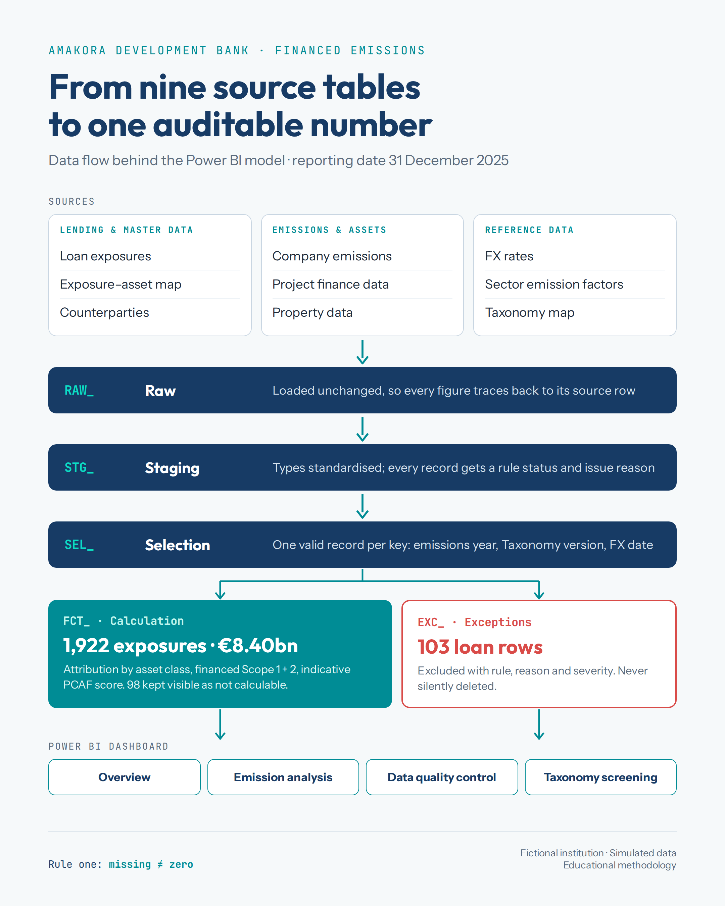

# Financed Emissions Reporting: Amakora Development Bank

A Power BI model that consolidates, validates and calculates financed Scope 1 and 2 emissions for a fictional German bank, following PCAF attribution methods, with indicative data-quality scores, a simplified EU Taxonomy screening and a full exception trail.

> **Fictional institution. Simulated data. Educational methodology.**
> This is a portfolio project, not a regulatory submission. The source data contains deliberately injected quality problems.

## Why this project

While studying for the GARP Sustainability and Climate Risk (SCR) certificate, I learned how a bank attributes a share of a borrower's emissions to its financing and how PCAF grades data quality. This project applies that method to imperfect data: separate source systems, duplicates, missing values and conflicting records.

The full business problem is described in [Results/01_business_problem.md](Results/01_business_problem.md).

## Headline results

Reporting date 31 December 2025, all figures in EUR.

| Metric | Result |
|---|---|
| Valid exposures | 1,922 (from 2,025 source loan rows) |
| Valid exposure | €8.40bn |
| Financed Scope 1 + 2 emissions | 2,611,116 tCO2e |
| Emissions-calculation coverage | 93.6% of exposure |
| Calculated from reported data / estimates | 61.3% / 32.3% of exposure |
| Economic emission intensity | 332 tCO2e per €m |
| Exposure-weighted indicative PCAF score | 2.21 (1 = best, 5 = lowest) |
| Potentially Taxonomy-eligible exposure | 78.4% (16.6% not eligible, 5.0% unmapped) |
| Loan rows excluded with a documented reason | 103 |

## Portfolio by asset class

| Asset class | Exposures | Exposure | Financed emissions | Attribution denominator |
|---|---|---|---|---|
| Corporate loans and revolving credit | 935 | €4.14bn | 1,473,935 tCO2e | EVIC, capped at 100% |
| Project finance | 489 | €2.28bn | 1,085,865 tCO2e | Total project equity and debt |
| Commercial mortgages | 498 | €1.98bn | 51,316 tCO2e | Property value at origination |

## Approach

**1. Layered data model.** Nine source tables move through separate layers so every figure can be traced back to its source row:

| Layer | Prefix | Purpose |
|---|---|---|
| Raw | `RAW_` | Source data loaded unchanged |
| Staging | `STG_` | Types standardised; every record gets a rule status and issue reason |
| Selection | `SEL_` | One applicable record per key (emissions year, Taxonomy version, FX date) |
| Calculation | `FCT_` | Attribution, financed emissions, PCAF score, Taxonomy category |
| Exceptions | `EXC_` | Records that fail a rule, with rule ID, reason and severity |

**2. Validation and record selection.** Business rules cover uniqueness, positive balances, valid borrowers, reporting-date FX rates and valid emissions values. Where a borrower has several emissions records, one is selected by: most recent acceptable year, then assured over verified over unverified, then a usable and latest submission date, then record ID.

**3. Calculation.** Financed emissions = attribution factor × (Scope 1 + Scope 2). Reported emissions are always preferred. Where none are usable, corporate emissions are estimated as revenue × a NACE-mapped sector emission factor. Anything without valid inputs stays uncalculated.

**4. Indicative PCAF data-quality scores.**

| Data basis | Score |
|---|---|
| Reported and assured or verified emissions; property energy data with supplier-specific factors | 1 |
| Reported but unverified emissions; property energy data with average factors | 2 |
| Property emissions estimated from EPC rating and floor area | 3 |
| Revenue-based sector estimates; data-provider estimates for projects | 4 |

**5. Guiding rule: missing ≠ zero.** Missing values are never converted to zero. They stay visible as coverage gaps or exceptions.

## Dashboard

The Power BI report has four pages:

| Page | What it shows |
|---|---|
| Overview | Headline KPIs, emissions by sector and asset class, exposure share vs emissions share |
| Emission analysis | Economic intensity by sector, top counterparties, counterparty-level detail |
| Data quality control | PCAF score distribution, calculation blockers, exception review queue |
| Taxonomy screening | Potentially eligible, not eligible and unmapped exposure by sector |

## Repository contents

| File | Description |
|---|---|
| [`Results/Finance Emission.pbix`](Results/Finance%20Emission.pbix) | Power BI model and report |
| [`Data/`](Data/) | Simulated source workbooks |
| [`Results/01_business_problem.md`](Results/01_business_problem.md) | Business problem, scope, assumptions and limitations |
| [`Documentation/ESG_Stakeholder_Interview_and_Requirements_Guide.docx`](Documentation/ESG_Stakeholder_Interview_and_Requirements_Guide.docx) | Stakeholder interview approach |
| [`Documentation/ESG_Source_Data_Profiling_Specification.docx`](Documentation/ESG_Source_Data_Profiling_Specification.docx) | Profiling specification |
| [`Documentation/ESG_Data_Relationships_and_Validation_Rules.docx`](Documentation/ESG_Data_Relationships_and_Validation_Rules.docx) | Join logic and validation rules |
| [`Documentation/ESG_Data_Profiling_Complete_Report.docx`](Documentation/ESG_Data_Profiling_Complete_Report.docx) | Full data-profiling report |
| [`image/`](image/) | Dashboard screenshots |

## How to open

1. Install [Power BI Desktop](https://www.microsoft.com/power-bi/desktop) (free, Windows).
2. Download the repository and open [`Results/Finance Emission.pbix`](Results/Finance%20Emission.pbix).
3. If Power BI asks for the data source, go to **Transform data → Data source settings** and point it to the workbooks in `Data/`.

## Limitations

- The institution is fictional and all data is simulated.
- Sector emission factors are simplified educational values, and PCAF scores are indicative.
- Property valuations use an assumed origination date of 1 January 2020.
- The EU Taxonomy screening uses simplified NACE mappings only. It does not assess substantial contribution, Do No Significant Harm, minimum safeguards or alignment.
- Scope 3 emissions are available in the source data but excluded from the main KPI.

## Tools

Power BI Desktop · Power Query (M) · DAX · Excel

## Author

Amaka Ibeh · [LinkedIn](https://www.linkedin.com/in/amaka-ibeh-434542181)

